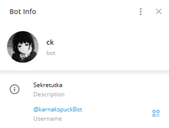

# Self TG Approve — Mistral Lite

Легковесный Telegram-бот для заявок в приватный канал и коротких разговоров через
Mistral API. Версия 2.0 не запускает локальные модели и не требует Docker, n8n,
PostgreSQL, Qdrant, LangChain или ffmpeg.



## Возможности

- `/join_request`: пользователь присылает мем, администратор получает кнопки
  «Одобрить» и «Отказать».
- Одобренный пользователь получает одноразовую ссылку с ограниченным сроком жизни.
- `/talk`: прямой асинхронный вызов Mistral Chat Completions API.
- Короткая история текущей сессии в оперативной памяти, ограниченная одновременно
  количеством сообщений, числом символов и TTL.
- `/clear` забывает контекст, `/stop_talk` завершает разговор.
- Никаких входящих портов: Telegram работает через long polling.

## Архитектура

```text
Telegram user ──HTTPS──> Python bot ──HTTPS──> Mistral API
       │                     │
       └── meme request ─────┴──> Telegram admin approve/reject
```

В runtime всего три закреплённые зависимости: `python-telegram-bot`, `httpx` и
`python-dotenv`. Состояние не пишется на диск и исчезает после TTL или перезапуска.

## Быстрый старт

Требуется Python 3.10 или новее.

```bash
python3 -m venv .venv
.venv/bin/python -m pip install --upgrade pip
.venv/bin/python -m pip install -r requirements.txt
cp .env.example .env
```

Заполните в `.env`:

- `TOKEN` — токен Telegram-бота;
- `CHANNEL_ID` — числовой ID или `@username` канала;
- `ADMIN_ID` — числовой Telegram ID администратора;
- `MISTRAL_API_KEY` — ключ Mistral API.

Запуск:

```bash
.venv/bin/python -m self_tg_approve
```

Одноразовая проверка Mistral без запуска Telegram polling:

```bash
.venv/bin/python -m self_tg_approve.check_mistral
```

Проверка Telegram-токена, канала и права создавать invite-ссылки:

```bash
.venv/bin/python -m self_tg_approve.check_telegram
```

## Настройки агентессы

| Переменная | По умолчанию | Назначение |
|---|---:|---|
| `MISTRAL_MODEL` | `mistral-small-latest` | Модель Free mode |
| `MISTRAL_MAX_TOKENS` | `600` | Максимальная длина ответа |
| `MISTRAL_TEMPERATURE` | `0.45` | Вариативность ответа |
| `SESSION_TTL_MINUTES` | `60` | Время жизни контекста |
| `SESSION_HISTORY_MESSAGES` | `12` | Число сохранённых реплик |
| `SESSION_HISTORY_CHARS` | `12000` | Максимальный размер истории |
| `MISTRAL_REQUEST_COOLDOWN_SECONDS` | `3` | Пауза между запросами пользователя |
| `MISTRAL_ALLOWED_USER_IDS` | пусто | Необязательный allowlist ID через запятую |
| `INVITE_LINK_TTL_HOURS` | `24` | Срок жизни ссылки на канал |

Если `MISTRAL_ALLOWED_USER_IDS` пуст, `/talk` доступен всем пользователям. Для
защиты бесплатной квоты можно указать, например,
`MISTRAL_ALLOWED_USER_IDS=123456789,987654321`. Администратор допущен всегда.

Агентесса отвечает на языке пользователя, не заявляет о постоянной памяти и не
может самостоятельно решать вопрос доступа. Системный промпт находится в
`self_tg_approve/prompts.py`.

## Проверки

```bash
.venv/bin/python scripts/validate_project.py
.venv/bin/python -m unittest discover -s tests -v
```

CI выполняет те же проверки на Python 3.12 и не использует реальные ключи.

## Установка на малый VPS

Рекомендуемая схема каталогов:

```text
/opt/self-tg-approve/releases/v2.0.0/  # код и отдельный venv
/opt/self-tg-approve/current           # symlink на активный релиз
/etc/self-tg-approve/bot.env           # root:root, mode 0600
```

Готовый unit: `deploy/self-tg-approve.service`. Он запускает непривилегированного
пользователя `selftg`, ограничивает память и не требует открывать порты. После
копирования unit:

```bash
sudo systemctl daemon-reload
sudo systemctl enable --now self-tg-approve
sudo systemctl status self-tg-approve
sudo journalctl -u self-tg-approve -n 100 --no-pager
```

Секретный `.env` никогда не коммитится. На сервер следует переносить только нужные
переменные, а не старые настройки удалённых сервисов.

## Mistral

Клиент использует официальный endpoint
`POST https://api.mistral.ai/v1/chat/completions`, Bearer-аутентификацию и модель
`mistral-small-latest`. При `429` и временных `5xx` выполняются короткие повторные
попытки; ключ, запросы и ответы не логируются.

- [Mistral Free mode](https://docs.mistral.ai/getting-started/quickstarts/studio/activate-and-generate-api-key)
- [Chat Completions API](https://docs.mistral.ai/api/endpoint/chat)
- [API errors](https://docs.mistral.ai/resources/error-glossary)

## Лицензия

Apache License 2.0.
